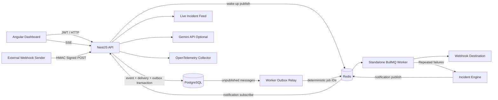

# OpsPulse

OpsPulse is a multi-tenant webhook and incident operations platform built with NestJS and Angular.

## Architecture



Webhook ingestion persists its event, delivery record, and outbox message in one
PostgreSQL transaction. The relay claims pending messages with
`FOR UPDATE SKIP LOCKED`, publishes BullMQ jobs using stable delivery-based IDs,
and marks messages as published. An ingestion wake-up reduces normal dispatch
latency; periodic polling recovers messages after Redis outages or process restarts.

## Stack

- Backend: NestJS 12, TypeScript, Drizzle ORM
- Frontend: Angular 21, TypeScript
- Database: PostgreSQL 16
- Queue/cache: Redis 7 + BullMQ
- Validation: Zod
- Auth: JWT access tokens + rotating refresh sessions
- Docs: Swagger at `/api/docs`
- Observability: OpenTelemetry + structured JSON logging

## Authentication

Passwords use Argon2id. The 15-minute access JWT stays in Angular memory; opaque
refresh tokens are SHA-256 hashed in PostgreSQL and delivered only in an
HttpOnly, `SameSite=Lax` cookie (`Secure` in production). Refresh and logout
require the paired `XSRF-TOKEN` cookie and `X-XSRF-TOKEN` header.

Keep API requests on same-origin relative URLs so Angular's XSRF interceptor
can attach the header. The development proxy forwards `/auth` to the backend;
production deployments should use a same-origin reverse proxy as well.

## Prerequisites

- Docker Desktop
- Node.js 22.12+
- npm

NestJS CLI code generators require Node.js 22.22.3 or newer.

## Repository layout

- `backend/src/modules/<feature>` contains feature modules, controllers, and services.
- `backend/src/common` contains cross-cutting HTTP and observability concerns.
- `backend/src/database` contains Drizzle schema and migration tooling.
- `frontend/src/app/core` contains app-wide infrastructure such as auth and interceptors.
- `frontend/src/app/features/<feature>` contains feature routes, UI, and data-access services.
- `frontend/src/app/shared` contains reusable UI and application services.

Root npm scripts delegate to the corresponding application packages:

```powershell
npm run build
npm test
npm run start:backend
npm run start:frontend
```

## Start infrastructure

```powershell
docker compose up -d postgres redis
```

Postgres is available on `localhost:5432`; Redis is available on `localhost:6379`.

## Run the containerized application

```powershell
docker compose up --build -d
docker compose ps
```

The Compose stack applies database migrations before starting the API and worker.
Open the dashboard at http://localhost:4200 and Swagger at
http://localhost:3000/api/docs. The local Compose default uses development cookie
settings for plain HTTP. For a TLS-terminated deployment, set `NODE_ENV=production`
and provide a strong `JWT_SECRET` and any required `GEMINI_API_KEY` in the
environment before starting the stack.

The API exposes `/health/live` and `/health/ready`; the latter checks PostgreSQL
and Redis. The worker runs separately from API replicas. Redis Pub/Sub carries
outbox wake-ups and incident notifications across those processes, while polling
continues to recover pending outbox messages. The worker health check requires
its own renewable Redis heartbeat as well as healthy database and Redis connections.

## Backend setup

```powershell
cd backend
npm install
npm run db:migrate
npm run seed
npm run start:dev
```

Swagger: http://localhost:3000/api/docs

Demo credentials:

- Email: `demo@opspulse.dev`
- Password: `Demo1234!`

Create a local `.env` from `.env.example`. Never commit real secrets.

## Frontend setup

```powershell
cd frontend
npm install
npm start
```

Dashboard: http://localhost:4200

The Angular development server proxies `/api`, `/auth`, and `/organizations` to port `3000`.

## Tests

```powershell
npm run build
npm test
```

## Key API routes

- `POST /auth/register`
- `POST /auth/login`
- `POST /auth/refresh`
- `POST /organizations/:organizationId/webhooks`
- `POST /api/webhooks/ingest/:endpointId`
- `GET /organizations/:organizationId/webhooks/deliveries`
- `POST /organizations/:organizationId/webhooks/deliveries/:deliveryId/replay`
- `GET /organizations/:organizationId/incidents`
- `POST /organizations/:organizationId/incidents/:incidentId/summarize`
- `GET /organizations/:organizationId/notifications/stream`

Webhook ingestion requires:

- `X-Webhook-Signature: sha256=<HMAC-SHA256(raw-body, secret)>`
- `X-Idempotency-Key: <unique-key>`
- Optional `X-Webhook-Event-Type: <event-type>`

Set `GEMINI_API_KEY` to enable Gemini summaries. Without it, the AI module uses a deterministic rule-based incident summarizer.
