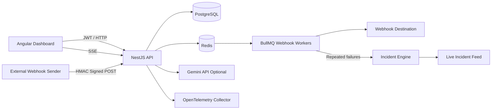

# OpsPulse

OpsPulse is a multi-tenant webhook and incident operations platform built with NestJS and Angular.

## Architecture



## Stack

- Backend: NestJS, TypeScript, Drizzle ORM
- Frontend: Angular 19
- Database: PostgreSQL 16
- Queue/cache: Redis 7 + BullMQ
- Validation: Zod
- Auth: JWT access tokens + rotating refresh sessions
- Docs: Swagger at `/api/docs`
- Observability: OpenTelemetry + structured JSON logging

## Prerequisites

- Docker Desktop
- Node.js 20+
- npm

## Start infrastructure

```powershell
docker compose up -d postgres redis
```

Postgres is available on `localhost:5432`; Redis is available on `localhost:6379`.

## Backend setup

```powershell
cd backend
npm install
npm run db:migrate
npm run seed
npm run start:dev
```

Swagger: http://localhost:3000/api/docs

Demo credentials:

- Email: `demo@opspulse.dev`
- Password: `Demo1234!`

Create a local `.env` from `.env.example`. Never commit real secrets.

## Frontend setup

```powershell
cd frontend
npm install
npm start
```

Dashboard: http://localhost:4200

The Angular development server proxies `/api`, `/auth`, and `/organizations` to port `3000`.

## Tests

```powershell
cd backend
npm run build
npm test
```

```powershell
cd frontend
npm run build
```

## Key API routes

- `POST /auth/register`
- `POST /auth/login`
- `POST /auth/refresh`
- `POST /organizations/:organizationId/webhooks`
- `POST /api/webhooks/ingest/:endpointId`
- `GET /organizations/:organizationId/webhooks/deliveries`
- `POST /organizations/:organizationId/webhooks/deliveries/:deliveryId/replay`
- `GET /organizations/:organizationId/incidents`
- `POST /organizations/:organizationId/incidents/:incidentId/summarize`
- `GET /organizations/:organizationId/notifications/stream`

Webhook ingestion requires:

- `X-Webhook-Signature: sha256=<HMAC-SHA256(raw-body, secret)>`
- `X-Idempotency-Key: <unique-key>`
- Optional `X-Webhook-Event-Type: <event-type>`

Set `GEMINI_API_KEY` to enable Gemini summaries. Without it, the AI module uses a deterministic rule-based incident summarizer.
